<p align="center">
  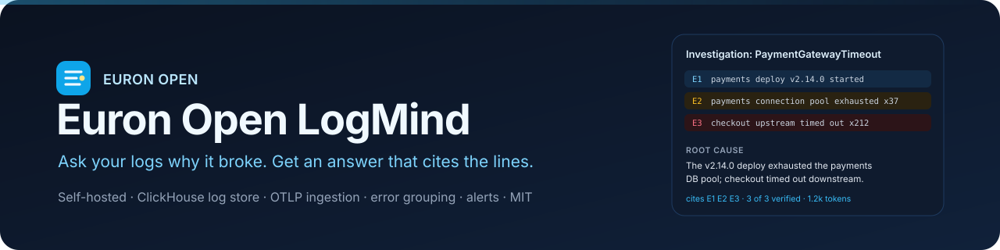
</p>

<p align="center">
  
  <a href="LICENSE"></a>
  
  
  
  
  
  
  
  
</p>

<p align="center">
  <a href="https://github.com/euron-sde-team/euron-open-logmind/stargazers"></a>
  <a href="https://github.com/euron-sde-team/euron-open-logmind/fork"></a>
  <a href="https://github.com/euron-sde-team/euron-open-logmind/watchers"></a>
  <br>
  <a href="https://github.com/euron-sde-team/euron-open-logmind/issues"></a>
  <a href="https://github.com/euron-sde-team/euron-open-logmind/pulls"></a>
  <a href="https://github.com/euron-sde-team/euron-open-logmind/commits/main"></a>
  
  <br>
  <a href="#built-by-the-team-behind-euron"></a>
</p>

<p align="center">
  <b><a href="#-quickstart">Quickstart</a></b> ·
  <b><a href="#️-architecture">Architecture</a></b> ·
  <b><a href="#-explore-the-repository">Explore the repo</a></b> ·
  <b><a href="docs/api/openapi.yaml">API reference</a></b> ·
  <b><a href="#️-deploy-to-aws">Deploy</a></b> ·
  <b><a href="docs/architecture/security.md">Security</a></b> ·
  <b><a href="#-documentation">Docs</a></b>
</p>

**Euron Open LogMind** is an open-source, MIT-licensed log intelligence platform, part of the
open-source initiative of **ENGAGESPHERE TECHNOLOGY PRIVATE LIMITED**. Your services send logs
over HTTP, the Python or Node.js SDK, or any OpenTelemetry exporter; LogMind redacts personal
data and secrets before storing anything, keeps the lines in ClickHouse, groups errors by
fingerprint, watches service health, alerts on thresholds and anomalies, and, when something
breaks, investigates with AI and returns a root cause where **every claim cites a real stored
log line you can open and re-verify**.

Search, grouping, live logs and alerts work with no AI at all. When AI is on, it never sees your
raw log volume: LogMind selects and compresses the evidence first, and records what each
investigation cost in tokens.

<p align="center">
  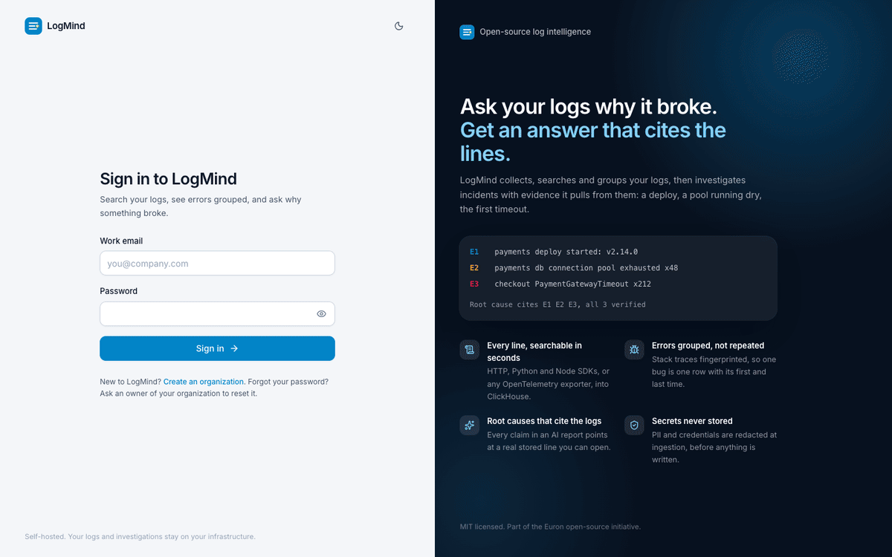
</p>

> [!NOTE]
> Everything in the tour ran for real: Docker Compose on a laptop, with S3, KMS and Secrets
> Manager emulated locally and provisioned by the same Terraform modules that build
> production. The logs went through the ingestion API, the investigation was run by the worker
> against the mock AI service, and its citations were verified against ClickHouse in the
> capture. `make up && make demo` reproduces it.

<h3 align="center">Built by the team behind Euron</h3>

<p align="center">Euron Open LogMind comes from the people who build these platforms. If you like how this repository is built, come and see what we build with it.</p>

<p align="center">
  <a href="https://euron.one"><picture><source media="(prefers-color-scheme: dark)" srcset="docs/assets/brand/euron-dark.svg"></picture></a>
  <a href="https://euronsystems.com"><picture><source media="(prefers-color-scheme: dark)" srcset="docs/assets/brand/euron-systems-dark.svg"></picture></a>
  <a href="https://alphaeuron.com"><picture><source media="(prefers-color-scheme: dark)" srcset="docs/assets/brand/alpha-euron-dark.svg"></picture></a>
</p>

<p align="center">
  <a href="https://www.instagram.com/euron_official"></a>
  <a href="https://www.linkedin.com/company/euronone/posts/"></a>
  <a href="https://x.com/euron712"></a>
  <a href="https://www.youtube.com/@Euron-official"></a>
  <a href="https://whatsapp.com/channel/0029VaeeJwq9RZAfPW9P2l07"></a>
</p>

---

## 📚 Table of contents

- [Why LogMind](#-why-logmind)
- [At a glance](#-at-a-glance)
- [Screenshots](#️-screenshots)
- [Features](#-features)
- [Architecture](#️-architecture)
- [Tech stack](#-tech-stack)
- [Prerequisites](#-prerequisites)
- [Quickstart](#-quickstart)
- [Send your logs](#-send-your-logs)
- [Explore the repository](#-explore-the-repository)
- [API](#-api)
- [Configuration](#️-configuration)
- [Deploy to AWS](#️-deploy-to-aws)
- [Security model](#-security-model)
- [Testing](#-testing)
- [Documentation](#-documentation)
- [Roadmap](#️-roadmap)
- [FAQ](#-faq)
- [Contributing, security and license](#-contributing-security-and-license)

## 💡 Why LogMind

When production breaks, the answer is in the logs, spread across services and buried under
thousands of identical lines. The genuinely self-hostable open-source log tools (Grafana Loki,
SigNoz, OpenObserve) store and search logs well but have no AI investigation at all. The
products that do ship AI root cause analysis (Sentry Seer, ClickHouse's AI notebooks) keep it
in their cloud tiers, unavailable to self-hosters at any price.

LogMind's bet is to ship that capability self-hosted, under a real open-source licence, with a
hard rule about trust: the model never quotes your logs, it can only point at numbered
evidence the server retrieved, and the server throws away every statement that does not point
at a real line. A report can prove itself: one click re-reads every cited line from storage.

## 📊 At a glance

| | |
| --- | --- |
| **Collection** | `POST /api/v1/logs`, batches of up to 1000 lines, OTLP/HTTP at `/v1/logs` (protobuf or JSON, gzip); Python and Node.js SDKs; project keys `lmk_<prefix>_<secret>` stored as a peppered HMAC |
| **Redaction** | Credentials, emails, card numbers (Luhn), SSNs and Aadhaar (Verhoeff), phones, IBANs, IPs, custom patterns; mask or keyed hash; applied before anything is stored |
| **Storage** | ClickHouse `log_events` ordered by tenant and time with skip indexes and a per-minute rollup; Postgres for everything relational |
| **Explorer** | Keyword, service, environment, level, time, trace and request filters; keyset pagination; histogram; a line's neighbours and its trace; live streaming over a WebSocket |
| **Error intelligence** | Fingerprints from exception type and in-app frames (Python, JS, Java, Go) or a message template; first and last seen, counts, affected services, trends, regressions |
| **AI root cause** | Evidence retrieval, compression by template under an item and token budget, cited report, server-side citation validation, one-click verification, grounded follow-ups, tokens per call |
| **Providers** | OpenAI, Anthropic, Gemini, Ollama, any OpenAI-compatible endpoint, and a deterministic mock; keys sealed with KMS |
| **Health and alerts** | Per-service volume, error rate, availability and status from logs alone; threshold and anomaly rules; email, signed webhooks, Slack |
| **Multi-tenant** | Organisations and projects scoped structurally in every repository; viewer, admin and owner roles; append-only audit log |
| **Infrastructure** | 12 Terraform modules (ClickHouse on EC2 among them), 3 environments; the whole `aws-dev` stack applied and destroyed against Floci |
| **Tests** | 137 API unit + integration (90% coverage), 70 web, 99 Python SDK, 93 Node SDK, 7 end to end (see [Testing](#-testing)) |
| **License** | MIT |

## 🖼️ Screenshots

<table>
  <tr>
    <td width="50%">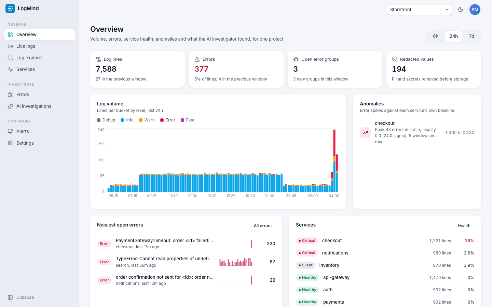<br><sub><b>Overview.</b> Volume by level, errors against the previous window, redacted values, error spikes against each service's own baseline, the noisiest errors, service health, investigations and alerts.</sub></td>
    <td width="50%">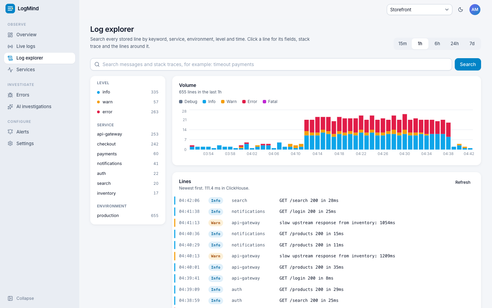<br><sub><b>Log explorer.</b> Keyword and facet filters, a level histogram and the lines, newest first, served from ClickHouse.</sub></td>
  </tr>
  <tr>
    <td>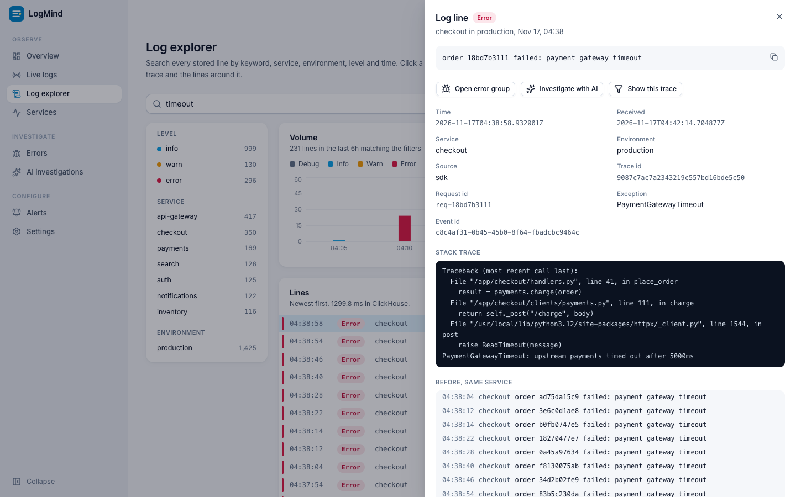<br><sub><b>A line in full.</b> Fields, stack trace, attributes, the lines around it from the same service and the rest of its trace.</sub></td>
    <td>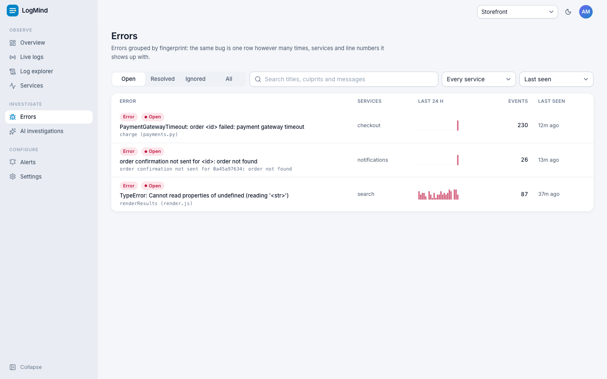<br><sub><b>Errors.</b> One row per bug: 230 timeouts with 230 different order ids and line numbers are one group.</sub></td>
  </tr>
  <tr>
    <td>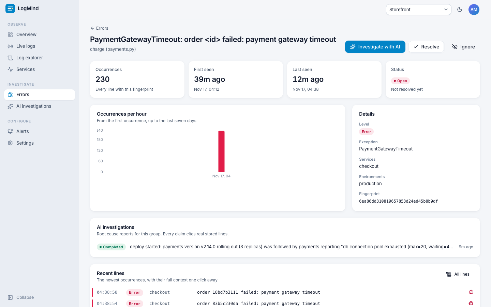<br><sub><b>Error group.</b> First and last seen, hourly trend, details, investigations and the recent lines; Investigate with AI starts here.</sub></td>
    <td>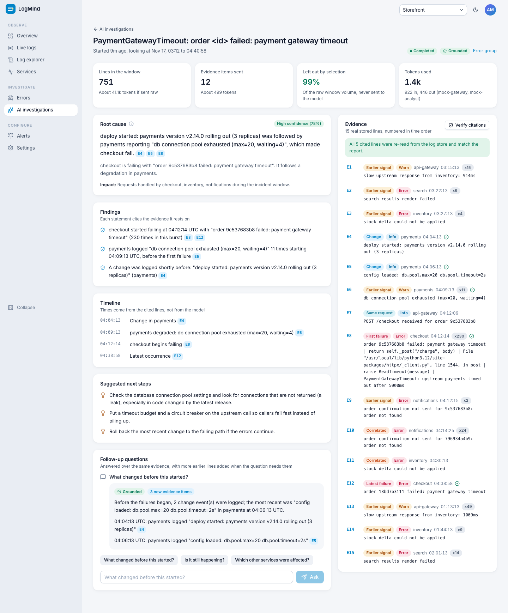<br><sub><b>AI investigation.</b> The root cause cites the deploy, the connection pool warnings and the first failure; the evidence on the right has been re-verified against ClickHouse.</sub></td>
  </tr>
  <tr>
    <td>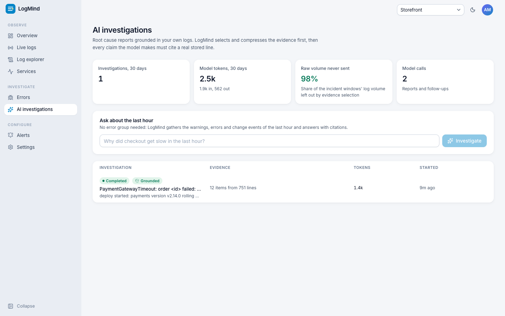<br><sub><b>AI investigations.</b> Every report with its evidence and token cost, and the share of raw volume that never reached the model.</sub></td>
    <td>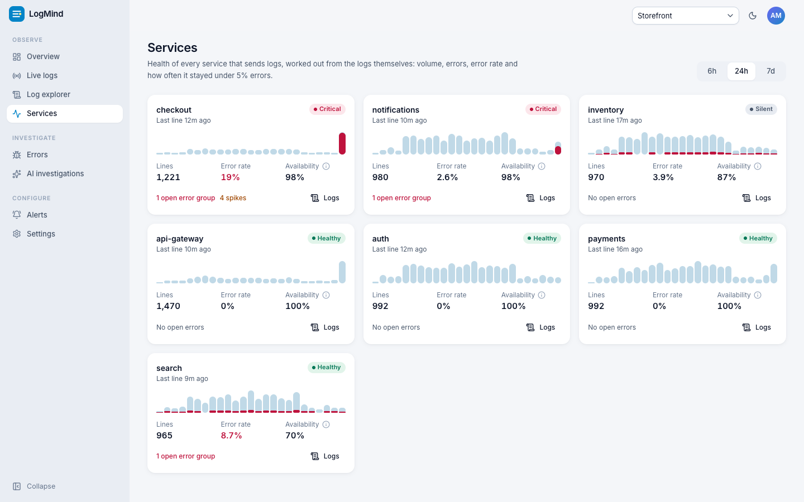<br><sub><b>Services.</b> Health from logs alone: volume and errors per hour, error rate, availability and status.</sub></td>
  </tr>
  <tr>
    <td>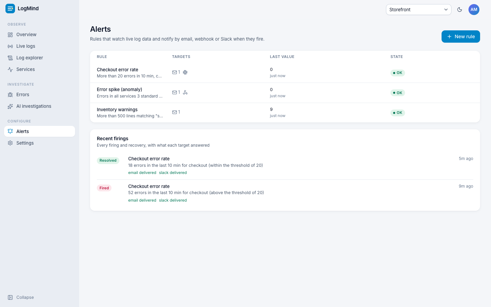<br><sub><b>Alerts.</b> Threshold and anomaly rules on live data, and every firing with what each target answered.</sub></td>
    <td>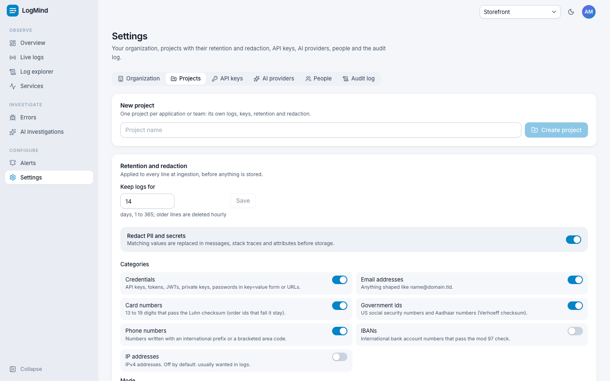<br><sub><b>Redaction.</b> Per-project categories, mask or hash, and a live preview of what would be stored.</sub></td>
  </tr>
  <tr>
    <td>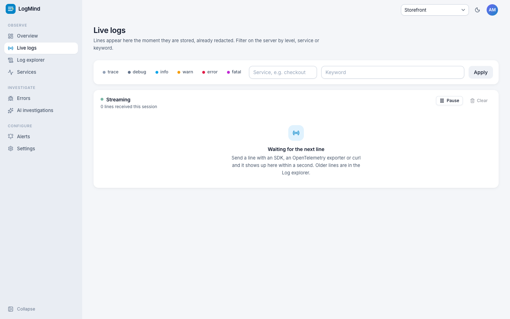<br><sub><b>Live logs.</b> Lines as they are stored, filtered on the server.</sub></td>
    <td>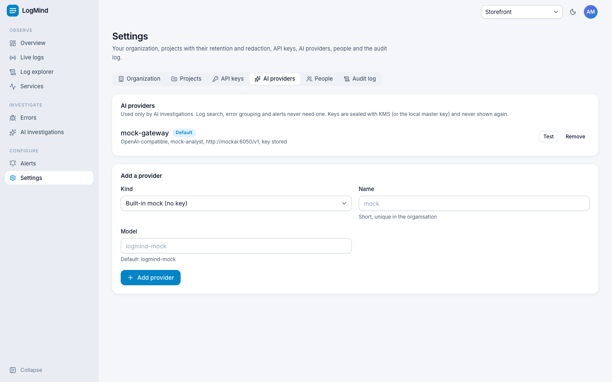<br><sub><b>AI providers.</b> Optional, per organisation, keys sealed; Test makes one small real call.</sub></td>
  </tr>
  <tr>
    <td>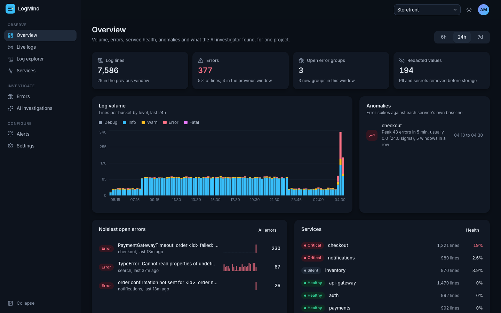<br><sub><b>Dark theme.</b> Every screen in both themes.</sub></td>
    <td>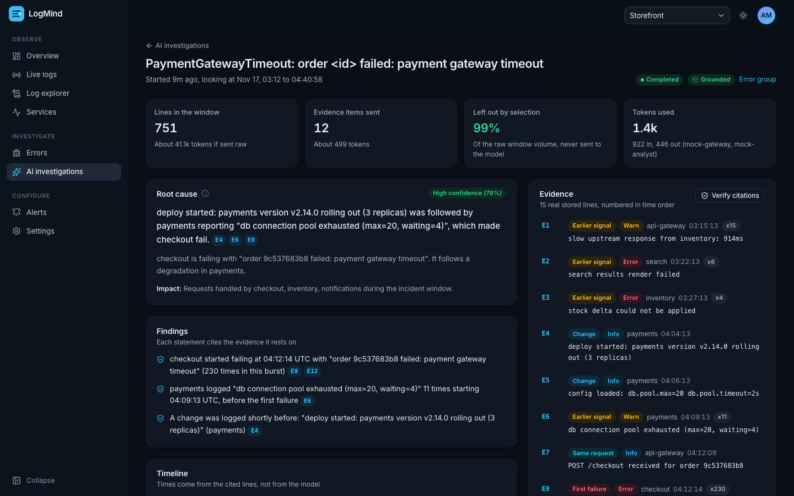<br><sub><b>Investigation, dark.</b></sub></td>
  </tr>
  <tr>
    <td>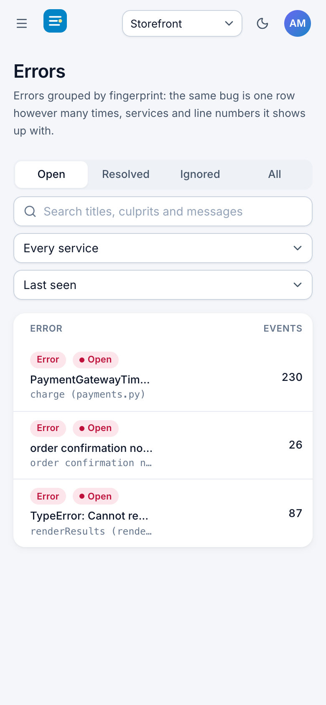<br><sub><b>Phone width.</b> Errors on a 390 px screen.</sub></td>
    <td>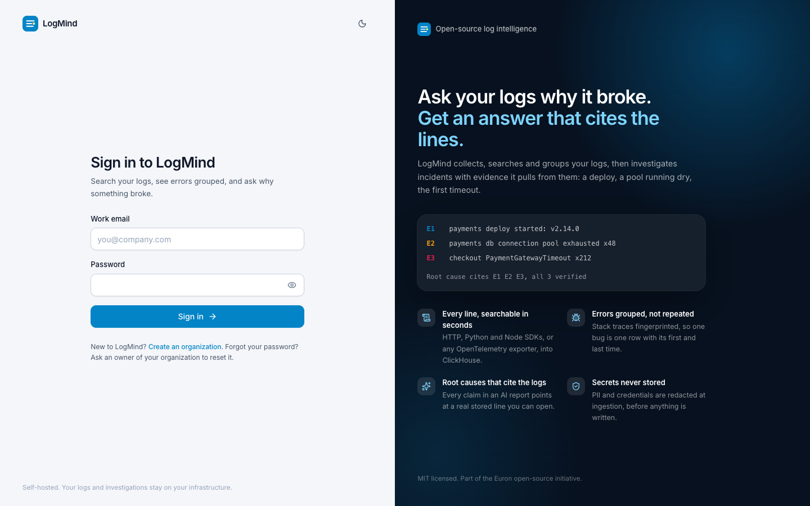<br><sub><b>Sign in.</b></sub></td>
  </tr>
</table>

## ✨ Features

**Collect from anything.** Native JSON (one line or batches), the Python SDK (background
batching, retries with `Retry-After`, a stdlib `logging` handler) and the Node.js SDK (zero
dependencies, exit-safe flushing), or any OpenTelemetry SDK or Collector: point the
`otlphttp` exporter at the API with the key as a header. Lines are queryable when the request
returns.

**Redact before storing.** Each project picks categories, adds patterns and chooses mask or
keyed hash. Values are replaced in messages, stack traces and nested attribute values before
the ClickHouse insert, before the error group sample and before the live stream, so a secret in
a log line never reaches a disk, a model or a browser. Checksums keep order ids from being
mistaken for card numbers.

**Find the line.** Keyword search across messages and stack traces, filters by service,
environment, level, trace and request id, a histogram per level, pagination that stays fast at
any depth, and a side sheet with the line's context. Live Logs streams new lines over a
WebSocket.

**One bug, one row.** Fingerprints ignore line numbers, ids, addresses and quoted values and
skip dependency frames, so a timeout thrown 230 times for 230 different orders is one group with its
first and last time, count, services, environments and hourly trend. Resolve or ignore it; a
new occurrence after a resolve reopens it as a regression.

**Ask why, get evidence.** An investigation finds where the current burst began, collects the
first and latest failures, earlier warnings and errors from other services, correlated errors,
deploys and config changes, and the failing request's own trace; collapses repeats into one
item with a count; ranks and trims to a budget; and asks the configured model for a cited
report. Statements that cite nothing real are removed and shown as removed. Follow-up questions
use the same evidence, and "what changed before this started?" pulls in earlier lines.

**Know what it cost.** Each investigation shows how many lines were in its window, how many
items were sent, the estimated tokens saved, and the provider-reported tokens; `GET
/api/v1/usage` sums them by day and model.

**Watch services, get told.** Per-service volume, error rate, availability and status from the
logs alone; threshold rules on errors, error rate, volume or matching lines; anomaly rules that
compare the last five minutes with the service's own baseline; email, signed webhooks and Slack
with cooldowns, recoveries and recorded delivery outcomes.

## 🏗️ Architecture

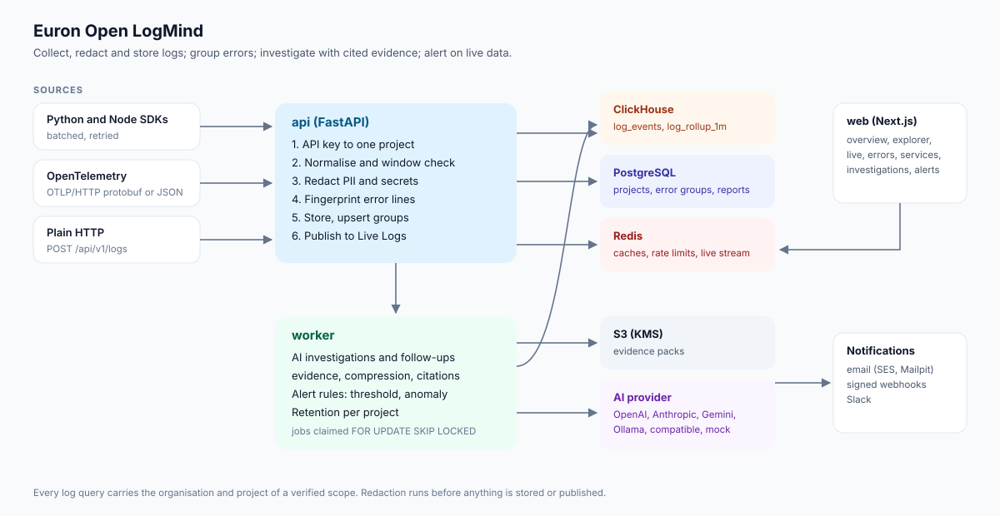

| Process | Role |
| --- | --- |
| `api` | FastAPI: ingestion (native, OTLP), the dashboard API, the live WebSocket |
| `worker` | AI investigations and follow-ups (Postgres queue, `SKIP LOCKED`), alert evaluation and delivery, retention |
| `web` | Next.js dashboard, session bridge and proxy |
| `migrate` | Alembic for Postgres, then the versioned ClickHouse schema |

### How an investigation stays grounded

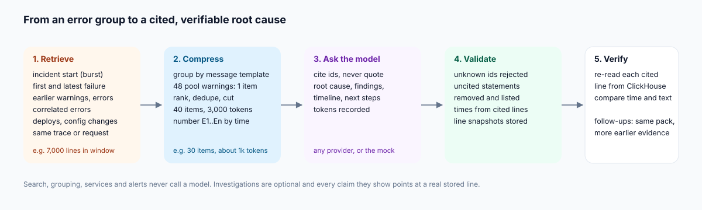

Details: [investigations.md](docs/architecture/investigations.md),
[ingestion.md](docs/architecture/ingestion.md), [alerting.md](docs/architecture/alerting.md),
[HLD](docs/architecture/HLD.md) (including the caching table).

## 🧰 Tech stack

| Layer | Choice |
| --- | --- |
| API, worker | Python 3.12, FastAPI, Pydantic v2, SQLAlchemy 2 async, Alembic, uv |
| Data | ClickHouse 24 (log lines), PostgreSQL 16, Redis 7, S3 (evidence packs) |
| Web | Next.js 15, React 19, TypeScript, Tailwind v4, shadcn/ui on Base UI, TanStack Query, Recharts |
| SDKs | Python (httpx), Node.js (TypeScript, no dependencies); OpenTelemetry OTLP/HTTP accepted directly |
| AI | OpenAI, Anthropic, Gemini, Ollama and OpenAI-compatible adapters; a deterministic mock |
| Infrastructure | Docker Compose, Floci (local AWS), Terraform (ECS Fargate, RDS, ElastiCache, ClickHouse on EC2, S3, KMS, Secrets Manager, SES, WAF, CloudWatch) |
| Tests | pytest, Vitest, Playwright, Puppeteer, tflint, checkov |

## 📋 Prerequisites

- Docker with Compose v2 and about 4 GB of memory for the stack
- To run tests or the SDKs outside containers: [uv](https://docs.astral.sh/uv/), Node.js 20
  or newer and pnpm

## 🚀 Quickstart

```bash
git clone https://github.com/euron-sde-team/euron-open-logmind.git
cd euron-open-logmind
make up      # Postgres, Redis, ClickHouse, Floci (Terraform applied), Mailpit, mock AI, api, worker, web
make demo    # "Lumen Retail": 24 h of logs from 7 services, an incident, alert rules, an investigation
```

Open http://localhost:6010 and sign in as `owner@lumen.example` with `Demo-Owner-Pass-1`.
Alert email lands in Mailpit at http://localhost:6025; the API's OpenAPI docs are at
http://localhost:6030/docs. [The walkthrough](docs/guides/walkthrough.md) tours the demo.

## 📤 Send your logs

Create a project and an API key in Settings, then:

```bash
curl -X POST http://localhost:6030/api/v1/logs \
  -H "Authorization: Bearer $LOGMIND_API_KEY" -H "content-type: application/json" \
  -d '{"message": "payment declined for order 42", "level": "warn", "service": "checkout"}'
```

```python
from euron_logmind import LogMind

log = LogMind(api_key="lmk_...", endpoint="http://localhost:6030", service="checkout")
log.info("order placed", order_id="o-42")
try:
    charge()
except Exception:
    log.exception("charge failed")
```

```js
import { LogMind } from "@euron/logmind";
const log = new LogMind({ apiKey: process.env.LOGMIND_API_KEY, service: "search" });
log.error("render failed", { route: "/search" });
```

```yaml
# OpenTelemetry Collector
exporters:
  otlphttp/logmind:
    logs_endpoint: http://localhost:6030/v1/logs
    headers:
      Authorization: "Bearer ${env:LOGMIND_API_KEY}"
```

More in [examples/](examples/) and the [Python](docs/guides/sdk-python.md) and
[Node](docs/guides/sdk-node.md) SDK guides.

## 🧭 Explore the repository

| Path | What |
| --- | --- |
| [apps/api](apps/api) | FastAPI service, worker, CLI, Alembic and ClickHouse schema, the mock AI service, tests |
| [apps/web](apps/web) | Next.js dashboard |
| [sdks/python](sdks/python), [sdks/node](sdks/node) | Client SDKs |
| [examples](examples) | Python and Node quickstarts, an OpenTelemetry Collector config, OpenTelemetry Python |
| [e2e](e2e) | Playwright suites |
| [infra/terraform](infra/terraform) | Modules and the `local-floci`, `aws-dev` and `aws-prod` environments |
| [infra/docker](infra/docker), [deploy/compose](deploy/compose) | Images and the Compose stack |
| [scripts](scripts) | Sanitization, env generation, test matrix, Terraform on Floci, QA and screenshots, benchmark |
| [docs](docs) | Architecture, guides, decision records, the OpenAPI document |

## 🔌 API

The OpenAPI document is [docs/api/openapi.yaml](docs/api/openapi.yaml) (drift tested against
the app); the running API serves it at http://localhost:6030/docs. Ingestion authenticates
with a project key (`Authorization: Bearer lmk_...` or `x-api-key`); everything else under
`/api/v1` with a dashboard session.

| Area | Endpoints |
| --- | --- |
| Ingestion | `POST /api/v1/logs`, `POST /api/v1/logs/batch`, `POST /v1/logs` (OTLP) |
| Logs | `GET /api/v1/logs`, `/logs/histogram`, `/logs/facets`, `/logs/{id}`, `/logs/{id}/context`, WebSocket `/api/v1/logs/live` |
| Errors | `GET /api/v1/errors`, `GET`/`PATCH /api/v1/errors/{id}` |
| AI | `POST /api/v1/ai/investigate`, `GET /api/v1/ai/investigations`, `/ai/investigations/{id}`, `/followup`, `/verify`, `/api/v1/ai/providers` |
| Health and analytics | `GET /api/v1/services`, `/analytics/overview`, `/analytics/anomalies`, `/usage` |
| Alerts | `GET`/`POST /api/v1/alerts`, `/alerts/{id}`, `/alerts/{id}/history`, `/alerts/{id}/test`, `/alerts/history` |
| Admin | auth, users, org, projects, keys, environments, audit log |

## ⚙️ Configuration

Every setting is an environment variable validated at boot; production refuses unsafe values.
The full reference is [configuration.md](docs/guides/configuration.md). The ones you are most
likely to touch: `CLICKHOUSE_URL`, `DATABASE_URL`, `REDIS_URL`, `KEY_MODE`/`KMS_KEY_ID`,
`STORAGE`/`EVIDENCE_BUCKET`, `MAIL_BACKEND`, `AI_MAX_EVIDENCE_ITEMS`, `AI_MAX_CONTEXT_TOKENS`,
`MAX_BATCH_EVENTS`, `ALERT_INTERVAL_S`.

## ☁️ Deploy to AWS

`infra/terraform/envs/aws-dev` and `aws-prod` provision a VPC, RDS PostgreSQL, ElastiCache,
ClickHouse on EC2 (AWS has no managed ClickHouse), S3, KMS, Secrets Manager, SES, ECR, ECS
Fargate behind an ALB with WAF, and CloudWatch alarms. `make aws-deploy ENV=aws-dev TAG=0.1.0`
builds, pushes, applies, migrates and rolls out. This project never applies to a real account
itself; `make tf-aws-on-floci` applies, re-plans and destroys the whole `aws-dev` environment
against an emulator instead. See [deploy-aws.md](docs/guides/deploy-aws.md).

## 🔐 Security model

- **Redaction before persistence**, per project, in messages, stack traces and attributes.
- **Structural tenant isolation**: every Postgres query carries the organisation, every
  ClickHouse query is built by one function that always adds organisation and project.
- **Grounded AI**: only statements citing real evidence are shown; `verify` re-reads them.
- **AI optional and bounded**: no model is called unless a provider is configured, and only a
  compressed, redacted evidence pack is ever sent.
- **Sealed secrets**: API keys as peppered HMACs; provider keys and alert URLs sealed with KMS;
  webhooks signed with HMAC-SHA256.
- **Boot guards**, rate-limited sign in, security headers, an append-only audit log.

Read [security.md](docs/architecture/security.md) and the
[threat model](docs/architecture/threat-model.md).

## 🧪 Testing

| Suite | Count | Run |
| --- | --- | --- |
| API unit | 90 | `make test` |
| API integration (real Postgres, Redis, ClickHouse, Mailpit; mock AI over HTTP) | 47 | `make test-integration` |
| API coverage (unit + integration) | 90% (5,597 statements) | `make test-integration` |
| Backend matrix (evidence storage local/S3 x sealing local/KMS) | 47 x 4 | `make test-matrix` |
| Web (Vitest) | 70 | `cd apps/web && pnpm test` |
| Python SDK | 95 unit + 4 integration | `cd sdks/python && uv run pytest` |
| Node SDK | 89 unit + 4 integration | `cd sdks/node && pnpm test` |
| End to end (Playwright) | 7 | `make e2e` |
| Browser QA (every page, light and dark, desktop and phone) | 76 page views, 0 problems | `make qa` |
| Terraform | validate 3/3, tflint clean, checkov 364 passed / 0 failed | `make tf-validate tf-lint tf-security` |
| AWS on Floci | 195 resources applied, re-plan adds and replaces nothing, destroyed | `make tf-aws-on-floci` |

Each of the twelve acceptance criteria in [PLAN.md](docs/PLAN.md) maps to named tests in
[testing.md](docs/guides/testing.md#acceptance-criteria).

**Benchmark** (`make bench`, [docs/bench.json](docs/bench.json)): measured on a 12-core laptop
whose Docker host was shared with several other stacks (load average about 50 during the run),
so treat these as a floor, not a ceiling.

| Measure | Result |
| --- | --- |
| Ingestion, 500-line batches, one client (redaction, fingerprinting, ClickHouse insert, Postgres upsert) | 1,512 lines/s; batch p50 181 ms, p95 1,417 ms |
| Ingestion, four concurrent clients | 1,969 lines/s |
| Keyword search over 40,000 lines, p50 / p95 | 82 ms / 440 ms |
| Filtered search (level and service), p50 / p95 | 53 ms / 630 ms |
| Histogram, p50 / p95 | 56 ms / 1,525 ms |

## 📖 Documentation

| Architecture | Guides |
| --- | --- |
| [High-level design](docs/architecture/HLD.md) | [Quickstart (local)](docs/guides/quickstart-local.md) |
| [Low-level design](docs/architecture/LLD.md) | [Product walkthrough](docs/guides/walkthrough.md) |
| [Data model](docs/architecture/data-model.md) | [Python SDK](docs/guides/sdk-python.md), [Node SDK](docs/guides/sdk-node.md) |
| [Ingestion, redaction, fingerprints](docs/architecture/ingestion.md) | [Configuration reference](docs/guides/configuration.md) |
| [AI investigations](docs/architecture/investigations.md) | [Deploy to AWS](docs/guides/deploy-aws.md) |
| [Alerting and anomalies](docs/architecture/alerting.md) | [Local against real AWS](docs/guides/local-with-aws.md) |
| [Security](docs/architecture/security.md), [threat model](docs/architecture/threat-model.md) | [Operations runbook](docs/guides/operations.md) |
| [Decision records](docs/architecture/adr/), [API reference](docs/api/openapi.yaml) | [Testing](docs/guides/testing.md), [Troubleshooting](docs/guides/troubleshooting.md) |
| | [Build plan](docs/PLAN.md), [changelog](CHANGELOG.md) |

## 🗺️ Roadmap

- Incident management as a tracked workflow (assignment, timeline, postmortem); 0.1.0 emits
  alerts only
- Deployment events as first-class records correlated with errors
- Kubernetes DaemonSet and Helm chart, Fluent Bit integration, OTLP over gRPC
- Metrics and trace correlation beyond log fields
- Custom dashboards, scheduled reports, CSV and PDF export
- Java and PHP SDKs
- A local model (Ollama) as an offline default
- ClickHouse replication and sharding modules

Have an idea? [Open a feature request](https://github.com/euron-sde-team/euron-open-logmind/issues/new/choose).

## ❓ FAQ

**Do I need an AI provider?** No. Collection, redaction, search, live logs, grouping, service
health and alerts work without one. Add one in Settings when you want investigations; the
built-in mock needs no key.

**Will my logs be sent to OpenAI?** Only if you configure OpenAI, and only the evidence pack of
an investigation you start: a few dozen already-redacted lines. Ollama or any
OpenAI-compatible server inside your network keeps everything local.

**Can the AI make things up?** It can reason badly, but it cannot show you a log line that does
not exist: it cites ids, the server checks each one, and statements without a real citation are
removed. Verify citations re-reads every cited line from ClickHouse.

**Why ClickHouse and not Postgres?** Logs are append-only, large and queried by time range with
aggregations: exactly what a columnar store is for. Postgres keeps everything relational
([ADR-0002](docs/architecture/adr/0002-clickhouse-for-log-events.md)).

**Does it replace my APM?** No. Service health here is derived from logs; metrics and traces
correlation is on the roadmap.

**Is it production ready?** It is built and tested to this program's standards locally, with
the AWS Terraform validated and applied against an emulator. It has not been run by us on a
real AWS account or had an independent security review; read
[security.md](docs/architecture/security.md) first.

## 🤝 Contributing, security and license

Contributions are welcome: read [CONTRIBUTING.md](CONTRIBUTING.md) and the
[code of conduct](CODE_OF_CONDUCT.md). Report security issues privately as described in
[SECURITY.md](SECURITY.md).

Released under the [MIT License](LICENSE). Copyright (c) 2026 ENGAGESPHERE TECHNOLOGY
PRIVATE LIMITED and the Euron Open LogMind contributors.

<p align="center">
  If LogMind helped you find why it broke, <b><a href="https://github.com/euron-sde-team/euron-open-logmind/stargazers">⭐ star the repository</a></b>.
</p>
