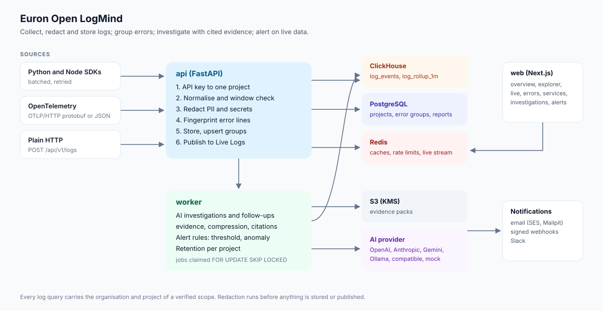

# High-level design

LogMind is four deployable processes and four stores.

| Process | What it does |
| --- | --- |
| **api** (FastAPI) | Ingestion (native HTTP, batches, OTLP), the dashboard API, the live log WebSocket |
| **worker** | AI investigations and follow-ups (Postgres queue), alert evaluation and delivery, retention |
| **web** (Next.js) | The dashboard; proxies `/api/*` with the session token and `/ws/logs` to the live stream |
| **migrate** (one-shot) | Alembic for Postgres, then the versioned ClickHouse schema |

| Store | Holds |
| --- | --- |
| **ClickHouse** | `log_events` (every line) and `log_rollup_1m` (per-minute counts by service, environment and level) |
| **PostgreSQL** | Organisations, users, projects, keys, environments, services, error groups and hourly occurrences, AI providers, investigations, follow-ups, token usage, alert rules and history, the audit log |
| **Redis** | Config cache version stamp, dashboard aggregate cache, rate limits, live stream pub/sub |
| **Object storage** (local disk or S3) | Investigation evidence packs |

## Request paths

**Ingestion** (`POST /api/v1/logs/batch`, `POST /v1/logs`). The API key resolves to one
project through the config cache. The batch is normalised, redacted, fingerprinted, inserted
into ClickHouse in one statement, then one Postgres transaction upserts error groups,
hourly occurrences, services and environments; the stored lines are published to the
project's Redis channel for Live Logs. The response returns when lines are queryable. See
[ingestion.md](ingestion.md).

**Search** (`GET /api/v1/logs`). One ClickHouse query, primary-key pruned to the project and
time window, with skip indexes for keyword, trace, request, fingerprint and event id.
Histograms, facets, service health and anomaly baselines read the rollup, not log lines.

**Investigation** (`POST /api/v1/ai/investigate`). Inserts a queued row and returns 202. A
worker claims it, collects and compresses evidence from ClickHouse, stores the pack in
object storage, calls the organisation's provider, validates citations and stores the
report. See [investigations.md](investigations.md).

**Alerts.** Every `ALERT_INTERVAL_S`, workers claim due rules one at a time with a row lock,
measure them against ClickHouse, record state changes, then deliver. See
[alerting.md](alerting.md).

## Scaling

The api and worker are stateless; run N replicas. Coordination is in the stores: jobs and
alert rules are claimed with `FOR UPDATE SKIP LOCKED`, the config cache invalidates through a
Redis version stamp, the live stream fans out through Redis pub/sub. ClickHouse is a single
node in 0.1.0 (a few billion lines on one node is ordinary for ClickHouse); replication and
sharding are roadmap.

## Caching

| Layer | What | Where | Key | TTL | Invalidation |
| --- | --- | --- | --- | --- | --- |
| Project config | API key lookup: secret hash, revoked flag, project, retention, compiled redactor | In process, per replica | `key:<prefix>` | `CONFIG_CACHE_TTL_S` (5 s) | Every project or key write bumps `logmind:cfg:version` in Redis; replicas compare it at most once a second and drop their copy |
| Dashboard aggregates | Overview and service health responses | Redis | `logmind:overview:<project>:<hours>`, `logmind:svc:<project>:<hours>` | `ROLLUP_CACHE_TTL_S` (10 s) | Time only: the data is append-only and a few seconds stale is acceptable |
| Per-minute rollup | Line counts by service, environment, level | ClickHouse (materialized view) | `(org, project, minute, service, environment, level)` | Retention | Written on insert; deleted with the lines by retention |
| Error group trend | Hourly occurrences per group | Postgres `error_occurrences` | `(group, hour)` | Retention of the group | Upserted by ingestion |
| Browser | React Query `staleTime` per kind (`lib/query-keys.ts`): live 5 s, lists 15 s, config 30 s, finished reports 60 s | The tab | Query key | As listed | Mutations invalidate the keys they touched |

Correctness of the config cache invalidation is covered by the integration tests that revoke a
key or archive a project and send again (`test_revoked_and_archived_keys_stop_ingestion`).

## Failure modes

| Dependency down | Effect |
| --- | --- |
| ClickHouse | Ingestion and search answer 503 `log_store_unavailable` with a clear message; the SDKs retry with backoff. Nothing is buffered in the API (buffering raw lines would store unredacted data or lose it on restart) |
| Postgres | 503 from the dashboard; ingestion fails after the ClickHouse insert, the client retries (at worst duplicated lines, never lost ones) |
| Redis | Rate limiter lets requests through and logs it; caches fall back to TTL; the live stream degrades, REST views still work |
| AI provider | The investigation is marked failed with the provider's message; nothing else depends on it |
| Mail / webhook / Slack | That delivery is recorded as failed on the history row; other channels still go out |
