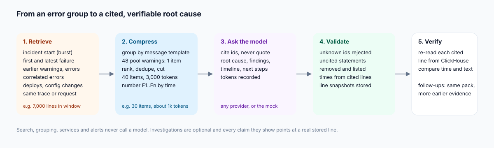

# AI investigations: evidence, compression, citations

The guarantee: **every statement a report shows cites a real stored log line of that
project, and anyone can re-check it.** The model is never trusted to quote logs; it can only
point at evidence the server gave it, and the server checks each pointer.



## 1. Evidence retrieval (`investigations/evidence.py`)

For an error group, the **incident start** is found by walking back from the latest
occurrence until a 15 minute gap: the start of the current burst, not the first time the
error was ever seen. The window is `[incident start - window_minutes, last seen + 2 min]`.
Then a handful of targeted ClickHouse queries, all through the project scope:

| Kind | What |
| --- | --- |
| `first_occurrence` | The first line of the burst, with the head of its stack trace and the burst size |
| `occurrence` | The latest line |
| `preceding` | Warnings and errors from any service before the first failure (and up to 2 minutes after), excluding the group itself |
| `correlated` | Errors in other services during the burst |
| `change` | Lines mentioning deploy, release, rollout, version, config, migration, restart, feature flag or scaled |
| `trace` | Lines sharing the first failure's trace id or request id |

Without an error group (a free question), the window is the last `window_minutes` and every
signal in it counts.

## 2. Compression

`preceding`, `correlated` and `change` are queried **grouped by message template** (the first
160 characters with digits folded), so 400 identical pool warnings become one item with
`count=400`, its first and last time, and one representative real line. Items are ranked
(first failure, latest failure, change, preceding, correlated, same request; errors and
higher counts rank higher), deduplicated by event id, cut to `AI_MESSAGE_CHARS`, and kept
while they fit `AI_MAX_EVIDENCE_ITEMS` (40) and `AI_MAX_CONTEXT_TOKENS` (3000). Survivors are
numbered `E1..En` in time order.

The pack records the raw volume of the window (`raw_lines`, and `raw_tokens_estimate` from
the total characters), and the estimate for what is actually sent. The demo's incident window
of about 7,000 lines reaches the model as about 30 items; the dashboard shows the share left
out.

The pack is stored in object storage (S3 or local disk), the row keeps only the key.

## 3. The prompt (`investigations/prompt.py`)

The system message names the task (`TASK: investigate` or `TASK: followup`) and the rules:
use only the pack, cite ids, never invent ids or text, uncited statements are discarded. The
user message has the group summary, the window, the question and the rendered evidence:

```
[E2] 2026-11-16T10:02:11.120Z service=payments level=warn kind=preceding count=48 last=... :: db connection pool exhausted (max=20, waiting=4)
```

The model answers with one JSON object: `summary`, `root_cause`, `root_cause_evidence`,
`confidence`, `impact`, `findings[{statement, evidence}]`, `timeline[{description, evidence}]`,
`suggested_fixes`, `follow_up_questions`.

## 4. Citation validation (`investigations/citations.py`)

- The JSON is parsed leniently (code fences, leading prose).
- Every cited id must be in the pack; anything else is recorded in `rejected_citations`.
- A finding, timeline entry or root cause left with no valid id is removed and listed under
  `discarded`, never shown as part of the report.
- Timeline times are set by the server from the earliest cited line, never by the model.
- Each surviving citation is resolved to its line: event id, timestamp, service, level, kind,
  count and message snapshot.
- `grounded` is true when there is a cited root cause and nothing was discarded.

## 5. Verification

`GET /api/v1/ai/investigations/{id}/verify` re-reads every cited event id from ClickHouse
through the investigation's own project scope and compares timestamp and message with the
report's snapshot. The dashboard's "Verify citations" button calls it; each evidence item
shows a check or a cross.

## 6. Follow-ups

`POST /{id}/followup` queues a turn. It is answered over the same pack plus the previous
turns' extra items. A question about what came before (before, changed, earlier, deploy,
trigger) first collects more evidence: change events and warnings in a window three times as
long before the incident, numbered after the existing items (`E31, E32, ...`). The answer goes
through the same validation; the verify endpoint covers its citations too.

## 7. Token usage

Every call writes an `ai_usage` row: provider, model, input and output tokens (as reported
by the provider, or estimated by the mock), the context estimate and the raw estimate.
`GET /api/v1/usage` sums them by day and model, with the share of raw volume never sent.

## Providers and the mock

Adapters (`providers/adapters/`) speak OpenAI chat completions (also every OpenAI-compatible
gateway), Anthropic messages, Gemini `generateContent` and Ollama chat, with retries on rate
limits and 5xx. The `mock` kind runs `investigations/mock_analyst.py` in process; the
`mockai` service runs the same analyst behind all four wire formats, which is what `make
demo` and `make e2e` use. The mock reasons the way the prompt asks: the first occurrence is
the symptom, the earliest strong earlier signal from another service (pools, timeouts,
refusals) is the cause, a deploy or release before it is the trigger, and it cites each. A
question containing `[mock:fabricate]` makes it cite an id that does not exist, which the
tests use to prove fabrications are dropped.
